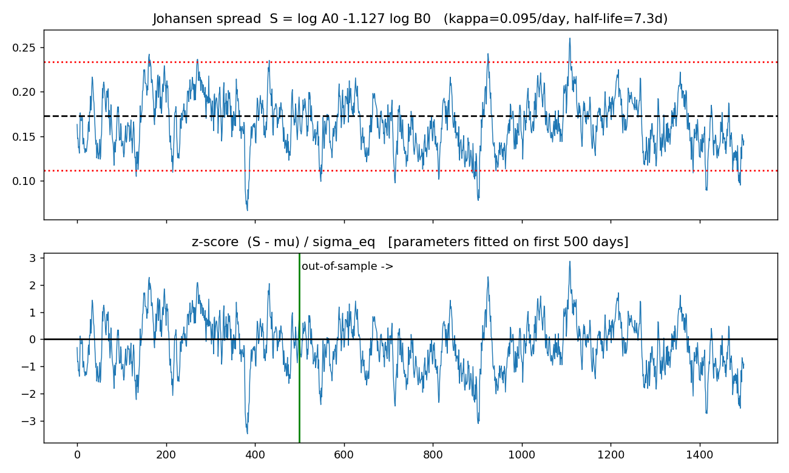
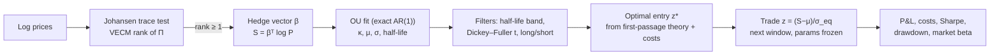
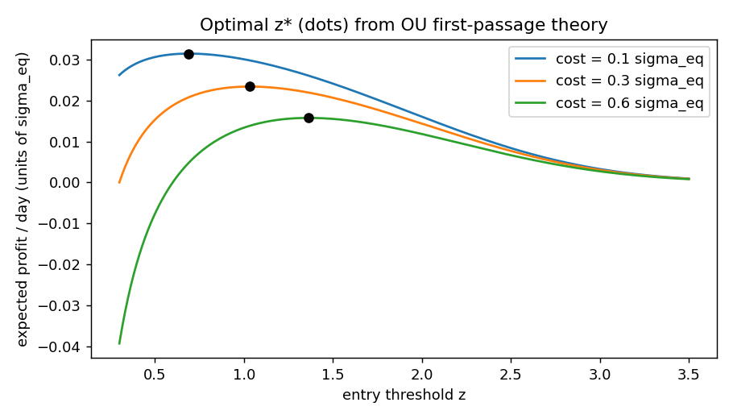
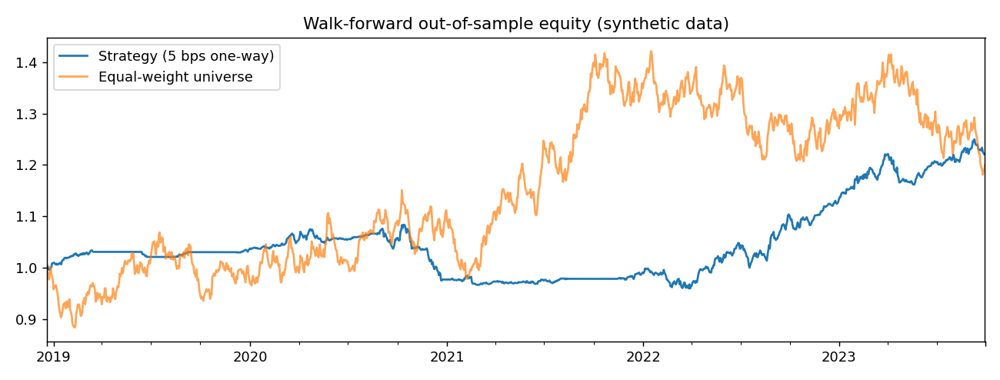

# Statistical Arbitrage Backtesting Engine

A walk-forward pairs-trading engine in **Python / NumPy / pandas / SciPy / statsmodels**.

* **Johansen cointegration test** builds stationary linear combinations of asset (log) prices. The
  hedge vector is orthogonal to the common stochastic trends, which is what isolates idiosyncratic
  mispricing from broad market beta.
* The resulting spread is modelled as an **Ornstein–Uhlenbeck (OU) process**. The SDE is solved in
  closed form, giving **mean-reversion half-lives** and **volatility-adjusted z-score thresholds**
  that are *optimal* under first-passage-time theory and trading costs.
* Everything is evaluated **out of sample** with frozen parameters and one-bar execution lag.

> 📐 **The maths is the point of this repo.** Every formula is derived in
> [`docs/MATH.md`](docs/MATH.md) and unit-tested against simulation.



---

## The pipeline



## The maths at a glance

**1. Cointegration (Johansen).** The VAR in levels is rewritten as a VECM

$$\Delta Y_t = c + \Pi Y_{t-1} + \sum_{j=1}^{k}\Gamma_j \Delta Y_{t-j} + \varepsilon_t,\qquad \Pi=\alpha\beta^\top .$$

The rank of $\Pi$ is the number of stationary combinations $\beta^\top Y_t$. After partialling out
the short-run terms, rank is tested through the eigenvalues of
$S_{11}^{-1}S_{10}S_{00}^{-1}S_{01}$ (squared canonical correlations $\hat\lambda_i$) with

$$\lambda_{\rm trace}(r) = -N\sum_{i=r+1}^{n}\ln(1-\hat\lambda_i).$$

**2. Why this neutralises beta.** If $Y_t=\Lambda F_t+u_t$ with common $I(1)$ factors $F_t$, then
$\beta^\top Y_t$ can only be stationary if $\Lambda^\top\beta=0$: the hedge vector cancels exposure
to every common stochastic trend. ([§3.2](docs/MATH.md#32-why-the-spread-is-isolated-from-market-beta))

**3. OU process.** $dX_t=\kappa(\mu-X_t)dt+\sigma dW_t$. Applying Itô's lemma to $e^{\kappa t}X_t$ gives

$$X_t=\mu+(X_0-\mu)e^{-\kappa t}+\sigma\int_0^t e^{-\kappa(t-s)}dW_s,\quad
X_\infty\sim N\!\Big(\mu,\tfrac{\sigma^2}{2\kappa}\Big),\quad t_{1/2}=\frac{\ln2}{\kappa}.$$

Sampled daily this is *exactly* an AR(1) with $b=e^{-\kappa}$, so OLS is the exact conditional MLE.

**4. Optimal thresholds.** Enter at $\pm z\sigma_{\rm eq}$, exit at $\mu$. Solving the hitting-time ODE
$\tfrac{\sigma^2}{2}T''-\kappa xT'=-1$ gives a remarkably clean expected cycle time

$$\mathbb E[\tau_{\rm cycle}]=\frac{\pi}{2\kappa}\operatorname{erfi}\!\Big(\frac{z}{\sqrt2}\Big),$$

and by the renewal–reward theorem the optimal entry maximises

$$\text{Rate}(z)\;\propto\;\frac{z-c/\sigma_{\rm eq}}{\operatorname{erfi}(z/\sqrt2)} .$$

The optimum depends only on the **cost-to-volatility ratio**, so noisier spreads and higher costs
get wider bands.



## Install

```bash
git clone https://github.com/<you>/stat-arb-engine.git
cd stat-arb-engine
pip install -e ".[dev]"        # numpy, pandas, scipy, statsmodels (+ pytest, matplotlib, yfinance)
```

## Quick start

```python
import numpy as np
from statarb import (make_universe, StatArbEngine, EngineConfig,
                     johansen_test, fit_ou, optimal_entry_threshold)

prices, truth = make_universe(n_days=1500, n_pairs=3, n_noise=5, seed=2)   # or your own DataFrame

# 1) the building blocks on one pair ---------------------------------------------------
Y = np.log(prices[["A0", "B0"]]).to_numpy()
jo = johansen_test(Y)                       # uses statsmodels if installed, else native NumPy
print(jo.rank, jo.trace_stats, jo.crit_values)
beta = jo.eigenvectors[:, 0]                # e.g. (1, -1.13): long A, short 1.13 B
ou = fit_ou(Y @ beta)
print(ou.kappa, ou.half_life, ou.sigma_eq)
z_star = optimal_entry_threshold(2 * 5e-4 * np.abs(beta).sum() / ou.sigma_eq)   # 5 bps one-way

# 2) full walk-forward backtest ---------------------------------------------------------
res = StatArbEngine(EngineConfig(formation_days=252, trading_days=63,
                                 top_n_pairs=5, cost_bps=5)).run(prices)
print(res.summary())
res.equity.plot()
```

Real data:

```python
import yfinance as yf
prices = yf.download(["KO", "PEP", "XOM", "CVX", "JPM", "BAC", "V", "MA"],
                     start="2015-01-01", auto_adjust=True)["Close"].dropna()
```

Run the full demo (prints metrics, regenerates the figures): `python examples/run_demo.py`

## Results (synthetic universe, illustrative)

3 planted cointegrated pairs + 5 independent random walks, 1,500 days, 5 bps one-way cost,
walk-forward 252-day formation / 63-day trading, top-5 slots (only 3 can be real):

| Metric | Value |
|---|---|
| Total return | 22.0% |
| Sharpe | 0.84 |
| Max drawdown | −11.4% |
| **Market beta** (vs equal-weight universe) | **0.03** |
| Trades / avg. holding | 183 / 13.3 days |
| Trade win rate | 76.5% |



**Read this honestly.** Synthetic data demonstrates that the *machinery recovers known truth*
(pairs, hedge ratios, half-lives) and that the strategy is market-neutral by construction. It
says **nothing** about real-world profitability. On real equities, expect far less edge: cointegration
relationships break, costs and borrow fees bite, and the pair-selection step faces a multiple-testing problem
(see [§8](docs/MATH.md#8-statistical-pitfalls)).

## Real data: engine vs. a static single pair

```bash
python examples/run_real.py          # 16 US stocks, 2018-2025, holdout = 2025 (needs internet)
```

This runs the walk-forward engine and, side by side, a *static* V/MA strategy fitted once on the
pre-holdout period (the classic notebook approach, with look-ahead, units and cost bugs removed). It
writes `results/comparison.csv`, `results/selected_pairs_by_window.csv` (an audit trail of which pairs
the engine believed in, with hedge ratio and half-life per window) and `results/comparison.png`.

Rules of the experiment: fix the configuration **before** looking at the holdout; select pairs on
training data only; report the holdout once. `--synthetic --pair A0 B0 --holdout-start 2022-06-01`
runs an offline smoke test. Its numbers are meaningless as evidence, because cointegration is stable
by construction there.

## Project layout

```
statarb/
  johansen.py   Johansen trace test: statsmodels backend + from-scratch NumPy reduced-rank regression
  ou.py         OU fit (exact AR(1)), exact simulation, closed-form cycle time, optimal z*
  engine.py     walk-forward screening, z-score state machine, P&L with costs, trade log
  metrics.py    Sharpe, CAGR, drawdown, market beta
  synthetic.py  universe generator with known cointegrated pairs
  baselines.py  static fit-once pairs strategy for comparison
tests/          unit tests: parameter recovery, closed form vs quadrature vs Monte-Carlo,
                test size, no-look-ahead, planted-pair recovery, native-vs-statsmodels cross-check
docs/MATH.md    full derivations
examples/run_demo.py   synthetic demo + figures
examples/run_real.py   real-data run: engine vs static pair
```

## Tests

```bash
pytest -q
```

What is verified:

* OU parameter recovery $(\kappa,\mu,\sigma)$ from simulated paths.
* Closed-form $\mathbb E[\tau_{\rm cycle}]$ equals numerical quadrature and a 2M-step Monte-Carlo.
* Optimal $z^*$ increases with cost and truly maximises the profit-rate function.
* Johansen finds a planted pair and recovers its hedge ratio; empirical test size ≈ 5% under drift.
* **No look-ahead:** appending future prices never changes earlier P&L.
* Native Johansen matches `statsmodels.coint_johansen` (eigenvalues and trace statistics) when
  statsmodels is installed. This cross-check is skipped without it, and CI runs it.

## Design decisions and known limitations

* **Critical values and drift.** The tabulated Johansen values assume drifting series. With weak
  drift the test over-rejects (measured ≈ 9–13% vs 5% nominal), so the engine adds a Dickey–Fuller
  confirmation on the spread (`max_adf_t`).
* **Thresholds are optimal for the OU model** (Gaussian, constant volatility, no jumps). Real spreads
  are fatter-tailed. The stop-loss at $|z|=4$ is a pragmatic guard, not part of the theory.
* **Not modelled:** borrow fees, short-sale constraints, market impact, intraday execution,
  survivorship bias in your data, dividends and corporate actions beyond what adjusted prices contain.
* Up to 5 series per Johansen test (the critical-value table implemented). Pairs are the default.
* Equal capital per pair, no risk-parity or Kelly sizing yet.

## Ideas for extension

Kalman-filter time-varying hedge ratios · bootstrap/Monte-Carlo critical values · FDR control
across pairs · Leung–Li optimal stopping with stop-loss in closed form · sector-constrained
pair screening · regime filters on $\hat\kappa$ stability.

## References

See [`docs/MATH.md`](docs/MATH.md#9-references): Johansen (1991, 1995), MacKinnon–Haug–Michelis (1999),
Engle–Granger (1987), Bertram (2010), Leung–Li (2015), Avellaneda–Lee (2010), Vidyamurthy (2004).

## License

MIT
